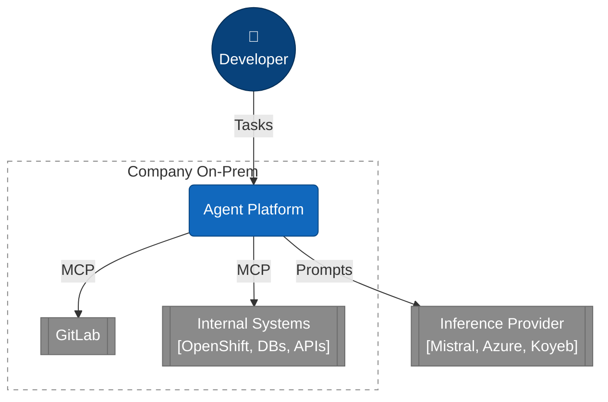

# Coding Agent

**Project website / GitHub Page:** [Coding Agent — Architecture Overview](https://ghinta.github.io/coding-agent/)

Architecture evaluation for an **agentic coding platform at a Company** with maximum data sovereignty: agents work on confidential code and internal systems, while LLM inference is consumed as an external service (no own GPUs, no own model hosting).

## Overview



The central question is **where the agent runtime lives** – this defines the trust boundary:

| | Variant A – Remote Inference | Variant B – Cloud Agent Runtime |
|---|---|---|
| Agent, memory, state | On-prem | Cloud |
| Tools | On-prem | On-prem, via MCP Gateway |
| LLM | External | External |
| Crosses the boundary | Minimized prompts only | Prompts, agent state, tool results |
| Security boundary | LLM Gateway (egress) | MCP Gateway (ingress) |
| Data sovereignty | Maximum | Reduced |

## Remote workspace architecture (under evaluation)

| Variant | Developer workspace | Agent security |
|---|---|---|
| **A – Integrated** | OpenShell workspaces | OpenShell |
| **B – Modular** | **Remote Development Platform** (Coder / OpenShift Dev Spaces / Eclipse Che) | Optional OpenShell sandbox |
| **C – Kubernetes-native** | **Remote Development Platform** (same candidates) | Restricted Kubernetes workloads, optionally Kata Containers |

**Independent layers:** workspace lifecycle, agent orchestration, sandbox/security, environment definitions (Dev Containers / Devfiles / optional Devbox), Knowledge Base/MCP, and inference routing. See the [full evaluation plan](remote-development-environments.md).

## Project Structure

```text
coding-agent/
├── README.md
├── agentic-workflows.md
├── remote-inference-agent-on-prem.md
├── remote-development-environments.md
├── cloud-agent-cloud-llm
└── sources/
    └── README.md
```

## Documents

| Document | Content |
|---|---|
| [Agentic Workflows](agentic-workflows.md) | Workflows that benefit from agentic architecture, including state, branching, parallelism and human-in-the-loop. |
| [Remote Inference – Agent On-Prem](remote-inference-agent-on-prem.md) | Agent runtime on-premises with external LLM inference. |
| [Cloud Agent + Cloud LLM](cloud-agent-cloud-llm) | Agent runtime and LLM hosted externally, with controlled access to internal systems. |
| [Remote Development Environments (evaluation)](remote-development-environments.md) | Three patterns: integrated OpenShell; Coder / OpenShift Dev Spaces / Eclipse Che with optional OpenShell; or Kubernetes-native agent isolation. Devbox remains optional. |

## Sources

The [`sources/`](sources/) folder contains supporting documents, vendor material, research notes and other source material used during the architecture evaluation.

## Status

Architecture evaluation – no implementation yet. Current focus: **Variant A – Remote Inference with the agent runtime on-premises**.

**Remote development workspaces are a proposed extension, not an implementation.** The **Remote Development Platform** category includes Coder, Red Hat OpenShift Dev Spaces and Eclipse Che (Dev Spaces is based on Che). Evaluate three deployment patterns: **A: OpenShell integrated**, **B: Remote Development Platform + OpenShell**, and **C: Remote Development Platform + Kubernetes-native agent isolation**. OpenShell and Devbox are optional; no product has been chosen. Third-party PaaS-hosted devcontainers remain out of scope.
