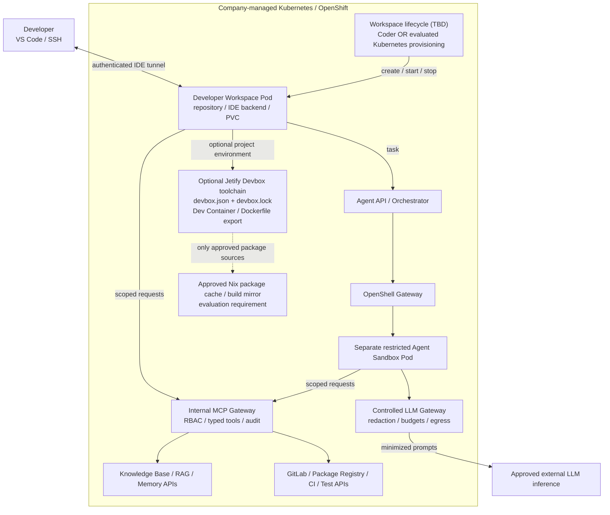

# Remote Development Environments — Evaluation Plan

**Status:** Architecture planning only. **No implementation, workspace product selection or CLI commitment.**

## Goals and boundaries

- Provide secure, reproducible **remote development workspaces on company-managed Kubernetes / OpenShift** (on-premises or company-controlled infrastructure).
- Developers use **VS Code / SSH** to work with source code, language runtimes, testing and approved internal services.
- **Evaluate Coder and Jetify Devbox** without selecting either. They solve different layers and may be combined.
- Retain the existing architecture: confidential source, agent orchestration, RAG/knowledge, memory, MCP tooling, GitLab, CI and sensitive state remain under company control. Approved remote LLM inference is accessed through the existing controlled gateway.
- **Out of scope:** Devcontainers hosted directly on third-party PaaS, hosted Jetify Devspace workspaces, implementing a custom CLI, or deploying a production workspace platform during planning.

## Key architectural distinction

| Product | Primary role | Does not provide on its own |
|---|---|---|
| [Coder](https://coder.com/docs/user-guides/devcontainers) | Self-hosted workspace control plane: templates, provisioning, access and lifecycle | Agent security isolation (OpenShell is separate); standardized project packages without a chosen environment definition |
| [Jetify Devbox](https://www.jetify.com/devbox) | Reproducible project-level shell and toolchain using **Nix**, `devbox.json` and `devbox.lock`; can generate a Dockerfile / Dev Container | Remote workspace provisioning, Kubernetes pod lifecycle, central workspace access control or OpenShell sandbox isolation |

**Coder and Devbox are not one-to-one substitutes.** Evaluation tracks: (A) Coder with conventional Dev Containers, (B) Devbox-defined containers with a **separately evaluated Kubernetes workspace lifecycle**, and (C) Coder with Devbox-defined tooling. All tracks stay on company-managed infrastructure. No combination is selected in advance.

## Proposed C4-style deployment view

**Trust-boundary rule:** The interactive developer workspace is **not** an agent sandbox. OpenShell runs untrusted agents with a separately enforced execution identity and network/filesystem policy. Neither Coder nor Devbox substitutes for these controls. Their integration is still unverified.

## Components and access model

| Component | Evaluation target | Access boundary |
|---|---|---|
| Workspace lifecycle | Coder control plane or a company-managed Kubernetes provisioner **to be determined** | OIDC/SSO (where supported), per-user/project namespaces, start/stop, audit |
| Dev Container / workspace pod | Source checkout, IDE backend, persistent storage and approved build/test tooling | No cluster-admin, host Docker socket or privileged execution by default |
| Devbox (optional) | Pinned package versions, reproducible scripts, exported Dev Container / Dockerfile | Versioned project configuration and `devbox.lock`; no unapproved public package egress |
| Agent API + OpenShell | Launch restricted agent task in a **separate** sandbox | Distinct agent identity, policy, approval gates |
| Knowledge Base / RAG | Internal search, conventions and project documentation | Project-scoped retrieval API; no direct database credentials |
| Agent state and memory | Checkpoints and structured task history | Agent API, not unrestricted PostgreSQL access |
| Internal tools | GitLab, CI, registry, tests, authorized DB/API workflows | Internal MCP Gateway and scoped credentials |
| Inference gateway | Approved enterprise LLM provider | Only selected/redacted context crosses the company boundary |

**Full tool availability** means the complete approved capability catalog is accessible from either workspace design via authorized APIs. It does **not** mean unrestricted shell, production, network, database or secret access.

## Evaluation matrix — different architectural responsibilities

| Question | Coder | Jetify Devbox | What needs verification |
|---|---|---|---|
| Kubernetes workspace lifecycle | Purpose-built management and templates | **Not a workspace provisioner** | If Devbox-first: what starts, stops and secures pods? |
| Workspace connectivity | Remote IDE / SSH integration | Local CLI and editor integration; does not itself establish remote Kubernetes sessions | Use the same VS Code connectivity tests |
| Environment definition | Dev Container files and image/build workflow | `devbox.json`, `devbox.lock`, Nix packages/scripts; `devbox generate devcontainer` | Compare reproducibility and image-build workflows |
| OpenShift compatibility | Check templates, builders and controller permissions | Check Nix installation, image build and generated container constraints | SCC/non-root, PVC, rootless image builds |
| Identity and audit | Evaluate central workspace governance | Relies on its workspace host/provisioner for access governance | Per-user/project authorization and traceability |
| Package supply chain | Registry/image governance | Nix package resolution, caches, lockfile and reproducibility | Approved internal mirrors; no arbitrary internet |
| OpenShell integration | Via workspace-to-agent API handoff | Via workspace-to-agent API handoff | Both must keep agent sandbox separate |
| Operations and cost | Assess server, templates, licensing and support | Assess Devbox/Nix maintenance, package caches and supplementary provisioning | Compare **complete end-to-end stacks**, not CLI vs. server prices |

**OpenShift constraint:** Do not assume Docker-in-Docker, a shared host Docker socket, privileged pods or cluster-admin are available. Evaluate appropriate non-privileged image building, including Coder Envbuilder where applicable. Devbox-generated Dev Containers must work under the selected SCC/UID and filesystem policy.

## Devbox-specific security questions

- Can `devbox shell`, `devbox run` and generated Dev Container workflows operate without unrestricted outbound network access?
- Which calls are made to Nixhub, nixpkgs, public binary caches, GitHub or optional Jetify Cloud? Identify, explicitly approve or replace them with internal mirrors and prebuilt images.
- Can approved package closures be prepared and cached internally by CI before developer workspaces start?
- Are `devbox.json` and `devbox.lock` committed, reviewed and scanned? Can versions and package sources be restricted?
- Are Devbox-generated Dockerfiles compatible with non-root OpenShift SCC and internal registries?
- Is cloud authentication / remote secret synchronization unnecessary and disabled for confidential projects?
- Can the same definition be reused in local development, Kubernetes workspaces and controlled CI without divergence?

## Security invariants

- **Identity:** Enterprise authentication, project RBAC, distinct workspace and agent identities.
- **Network:** Default-deny with enforced ingress/egress Kubernetes NetworkPolicy. Approved KB, MCP, GitLab, registry, CI, package-cache and gateway endpoints only.
- **Isolation:** Separate developer workspace and OpenShell sandbox processes/pods/permissions; no privileged shared mounts.
- **Tool safety:** Typed MCP tools, policy checks and human approval for sensitive writes.
- **Storage:** Scoped PVCs, secure workspace deletion, encryption/retention and cross-project access tests.
- **Secrets:** Broker short-lived, task-scoped capabilities rather than placing production credentials in a shell.
- **Supply chain:** Approved images, lockfiles and package caches; no silent public downloads.
- **Audit:** Capture workspace lifecycle, tool calls and approvals without exporting confidential traces.
- **Changes:** Prefer branch/diff/review workflows over direct writable mounts shared with an untrusted agent.

## CLI and interface policy — undecided

- Start by evaluating **Coder's workspace CLI / IDE access** for provisioning and **Devbox's `devbox shell`, `devbox run` and generation commands** for reproducibility.
- Do **not** treat the Devbox CLI as a replacement for workspace create/list/open/stop/delete functions.
- A company-specific thin CLI or portal is only a possible **future** facade if the evaluation reveals lifecycle or integration gaps. No implementation is planned now.

## Planned evaluation (no implementation yet)

1. **Architecture / threat model:** Confirm OpenShift SCC, CNI enforcement, identities, KB/MCP contracts, runtime isolation and approved package supply chain.
2. **Track A — Coder:** Test a company-managed Kubernetes workspace with a conventional `devcontainer.json`, VS Code, PVC and scoped tool access.
3. **Track B — Devbox:** Test `devbox.json` / `devbox.lock`, generated Dev Container and toolchain. Separately identify a compliant Kubernetes workspace provisioner and remote IDE connection; do not assume Devbox supplies them.
4. **Track C — Combination:** Assess Coder-provisioned workspaces using Devbox-generated or Devbox-managed project tooling.
5. **Common integration / denial tests:** Same repository and tests; KB search, GitLab, MCP, CI, OpenShell task handoff, persistence, identity; deny unknown egress, cross-project access, secret retrieval, privilege escalation and unauthorized writes.
6. **Decision gate:** Assess complete candidate architectures against security, IDE UX, reproducibility, Kubernetes fit, operability, cost, maintenance and portability. **No selection without evidence.**

**Acceptance target:** Any approved architecture provides secure VS Code development on company-managed Kubernetes/OpenShift, the required internal Knowledge Base and MCP tooling, isolated OpenShell agent execution and strictly controlled external LLM inference.

## Reference documentation

- [Dev Containers specification](https://containers.dev/)
- [Coder: Dev Containers](https://coder.com/docs/user-guides/devcontainers)
- [Coder: Working with Dev Containers](https://coder.com/docs/user-guides/devcontainers/working-with-dev-containers)
- [Jetify Devbox: Overview](https://www.jetify.com/devbox)
- [Jetify Devbox: Documentation](https://www.jetify.com/docs/devbox)
- [Jetify: Generate Dockerfile and Dev Container](https://www.jetify.com/blog/creating-nix-powered-docker-containers-with-devbox)
- [Jetify: Nix package cache considerations](https://www.jetify.com/blog/dont-rebuild-yourself-an-intro-to-nix-package-caches)
- [OpenShell: Kubernetes setup](https://docs.nvidia.com/openshell/kubernetes/setup)
- [OpenShell: Sandbox policies](https://docs.nvidia.com/openshell/latest/how-it-works/policies/overview)
