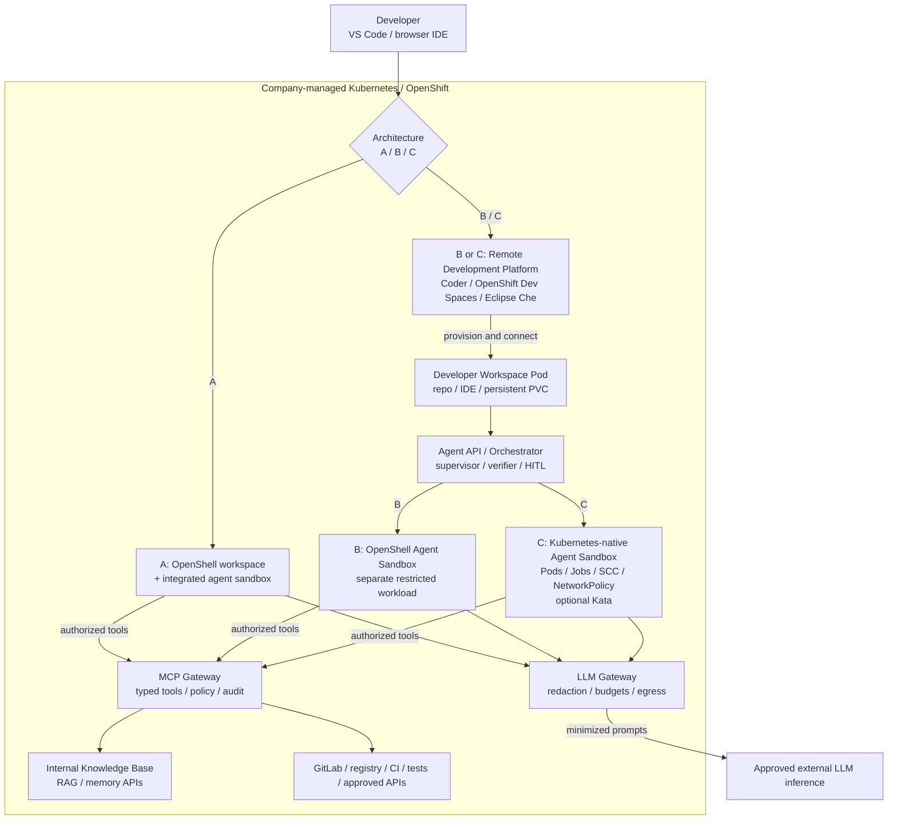

# Remote Development Environments — Architecture Evaluation

**Status:** Planning only. No product selected, no workspace platform implemented, and no custom CLI committed.

**Project website:** [Coding Agent — GitHub Page](https://ghinta.github.io/coding-agent/)

## Goals and constraints

- Remote developer workspaces on **company-managed Kubernetes / OpenShift** (on-premises or company-controlled infrastructure), accessible from **VS Code** and/or a supported browser IDE.
- Full **authorized** access to internal Knowledge Base / RAG, agent memory APIs, GitLab, MCP tools, package registry, CI, tests and approved databases/APIs.
- Confidential source, agent state, memory, traces and tool credentials stay within company-controlled infrastructure. Only minimized requests traverse the approved external LLM inference gateway.
- **OpenShell is optional**, including the possibility of an integrated OpenShell workspace. Every core capability must also have an architecture path **without OpenShell**.
- Prefer replaceable components over product-specific dependencies. Evaluate before choosing.
- **Out of scope:** Third-party PaaS-hosted devcontainers, vendor-specific production implementation in this planning phase, and an in-house CLI unless a demonstrated need arises.

## Independent architecture layers

| Layer | Candidates or design | Responsibility |
|---|---|---|
| **Remote Development Platform** | **Coder**, **Red Hat OpenShift Dev Spaces**, **Eclipse Che** | Provision developer workspaces; IDE access, user/team lifecycle, templates, storage |
| **Integrated workspace and agent option** | **OpenShell** (architecture A) | Evaluate whether its Kubernetes workspaces, CLI/SSH and sandbox are sufficient without a separate Remote Development Platform |
| **Agent Sandbox & Security** | **OpenShell** **or** **Kubernetes-native controls** | Secure untrusted agent execution separately from human workspaces |
| **Agent Orchestration** | LangGraph or another runtime behind an API | Planning, execution, checkpoints, supervision, verification, HITL |
| **Development Environment** | Dev Containers (`devcontainer.json`), Devfiles (`devfile.yaml`), optionally Jetify Devbox | Reproducible project dependencies, tooling and commands |
| **Knowledge Base & Tooling** | Internal RAG/Memory APIs, MCP Gateway, GitLab, CI/CD | Project-scoped access to required capabilities |
| **LLM Inference** | Approved enterprise providers via the LLM Gateway | External inference, provider independence, data minimization, budgets |

**Relationship:** OpenShift Dev Spaces is Red Hat's supported product based on **Eclipse Che**. They are separate offerings to assess, not independent underlying architectures. Coder, Dev Spaces and Che form the **Remote Development Platform** category; OpenShell is an optional integrated route or an optional agent-security layer.

**Devbox:** Jetify Devbox is **not** a workspace manager or an agent security boundary. Evaluate only as a supplementary Nix-based toolchain if pinned dependencies / generated Dev Containers add measurable value. Otherwise omit it.

## Three architecture variants — no preference yet

| Variant | Remote development | Agent execution / isolation | Trade-off to evaluate |
|---|---|---|---|
| **A — Integrated OpenShell** | OpenShell Kubernetes workspace + IDE / SSH integration | OpenShell sandbox and supervisor | Least additional platform infrastructure; verify everyday developer usability and enterprise governance |
| **B — Modular with OpenShell** | **Remote Development Platform**: Coder / OpenShift Dev Spaces / Eclipse Che | Separate **OpenShell** agent sandbox | Full workspace platform plus integrated agent-policy boundary; integration and operational complexity |
| **C — Kubernetes Native (no OpenShell)** | **Remote Development Platform**: Coder / OpenShift Dev Spaces / Eclipse Che | Dedicated Kubernetes Pods/Jobs + hardened controls; optional Kata Containers | Maximum independence from OpenShell; requires engineering and verification of equivalent security objectives |

### Proposed deployment and trust boundaries

**Diagram note:** Routes A, B and C are alternatives — not a mandatory chain. The general agent API/orchestration shown for B/C may also complement A when needed. In B/C, the interactive developer workspace **must not** be the untrusted agent's security boundary. OpenShell integration with each Remote Development Platform is a PoC requirement, not a proven plug-and-play feature.

## Remote Development Platform candidates

| Criterion | Coder | Red Hat OpenShift Dev Spaces | Eclipse Che |
|---|---|---|---|
| Positioning | Self-hosted developer/agent workspace platform | Red Hat-supported workspace product for OpenShift | Upstream open-source Kubernetes cloud development environment |
| Workspace lifecycle | Templates, API/CLI/UI, start/stop, access | Dashboard + DevWorkspace Operator | Dashboard + DevWorkspace Operator |
| Project definition | Templates and Dev Containers | Primarily **Devfile** | Primarily **Devfile** |
| IDE | VS Code and other remote IDEs | Browser IDE; desktop VS Code path must be validated for our constraints | Browser IDE; desktop VS Code path must be validated |
| Kubernetes/OpenShift fit | Validate templates, builds, non-root and permissions | OpenShift-focused; verify supported versions / subscriptions | Kubernetes-native; verify integration/support model |
| Identity/permissions | Assess SSO, RBAC, tenancy and governance | Assess OpenShift identity/RBAC, tenancy and governance | Assess Kubernetes/OIDC integration and RBAC |
| Operational ownership | Operate Coder control plane | Supported Red Hat product with lifecycle constraints | Operate upstream Che and operators |
| Evaluation status | **Not selected** | **Not selected** | **Not selected** |

**Note:** Red Hat OpenShift Dev Spaces and Eclipse Che share much of their technology stack. We must still compare support, update cadence, security patches, licensing, administrative experience and OpenShift compatibility separately.

## Security alternatives — OpenShell must not be required

| Security requirement | Variant A / B — OpenShell option | Variant C — Kubernetes-native option |
|---|---|---|
| Untrusted agent execution | OpenShell sandbox + supervisor | Restricted Pods/Jobs in dedicated namespaces |
| Runtime isolation | OpenShell sandbox policy / enforced supervisor boundary | SCC / Pod Security, rootless UID, seccomp, SELinux, optional Kata / VM-backed isolation |
| Network control | OpenShell policies **plus** enforced Kubernetes NetworkPolicy | Default-deny NetworkPolicy (enforced ingress + egress), egress firewall/proxy and allowed endpoints |
| Authentication / tool authorization | Identity + project-scoped MCP Gateway / OPA | Same independent MCP Gateway / OPA and project authorization |
| Secrets | Brokered, short-lived credentials; never give raw secrets to agent | Same via Vault/Secrets broker + tightly scoped ServiceAccounts |
| Filesystem | OpenShell policy + scoped volumes | Read-only rootfs where practical, scoped mounts/PVC, per-project separation |
| Audit and approval | Central self-hosted traces + HITL | Same independent traces + HITL |

**Important:** Kubernetes NetworkPolicy alone does **not** reproduce process, filesystem or credential mediation provided by an agent-specific sandbox system. Variant C must pass separate red-team/negative tests for process, filesystem, network, identity and secret boundaries. A Kubernetes Pod alone is not a sufficient isolation claim.

## Knowledge Base and tooling (same for all variants)

- Internal Knowledge Base / RAG: approved search/retrieval API, scoped by user, project and classification.
- Agent memory and task state: use Agent API; no unrestricted direct PostgreSQL access.
- MCP Gateway: typed, authenticated capabilities for GitLab, CI/CD, registry, tests, logs, internal APIs and approved read-only DB queries.
- No agent receives production credentials, cluster-admin, unrestricted internet access or bypass access to internal systems.
- Write operations use project-scoped authorization and HITL approval as appropriate.
- Inference: the LLM Gateway is the controlled external egress path; no cloud agent/runtime assumed by this design.

## Development Environment formats

| Format | Relevant platforms | What to evaluate |
|---|---|---|
| **Dev Containers** | Primarily Coder or compatible workspace setups | `devcontainer.json`, build strategy, OpenShift SCC, reproducibility, rootless builds |
| **Devfile** | OpenShift Dev Spaces / Eclipse Che | `devfile.yaml`, editor integration, workspace components, portability |
| **Jetify Devbox** (optional) | Supplemental project toolchain, not workspace manager | `devbox.json` / `devbox.lock`, Nix mirrors/caches, container exports, added value vs. images/devfiles |

Do not require every platform to natively understand the same specification. Compare equivalent outcomes with reference projects. If Devbox adds complexity without measurable benefit, leave it out of the target stack.

## CLI / client — future decision

First use existing Coder, Che/Dev Spaces, and OpenShell UI/CLI/IDE flows. Only consider a thin provider-neutral CLI or portal if UX requires it. This planning step implements **no** new client and commits to **no** API contract.

## Common evaluation and acceptance tests (future PoCs)

1. **Lifecycle and UX:** Create, connect, pause/stop, resume and delete a workspace; check VS Code Desktop and browser IDE where relevant.
2. **Persistence:** GitLab checkout, restart, PVC isolation, cleanup, user/project segmentation and source retention.
3. **Internal capabilities:** Complete authenticated Knowledge Base search, RAG retrieval, MCP tool discovery and GitLab/CI/test calls.
4. **Agent integration:** Controlled task launch, isolated code execution, diff/branch/review, LangGraph or equivalent orchestration and verification.
5. **Negative security tests:** Deny unknown egress, cross-project KB and storage access, secret exfiltration, privilege escalation, production writes and supervisor/gateway bypass.
6. **OpenShift compatibility:** SCC, non-root, CNI enforcing ingress/egress policy, storage classes, OIDC and supportability. Test any OpenShell namespace/cluster permissions explicitly.
7. **Operational evaluation:** Support status, updates, licensing, total cost, admin burden, recovery and vendor exit. Coder vs. OpenShift Dev Spaces vs. Eclipse Che are evaluated as **products**, not assumed to be three unrelated backends.
8. **Decision gate:** Compare A, B and C using the same functional/security acceptance criteria before selecting a Remote Development Platform or sandbox implementation.

**Acceptance target:** A chosen architecture delivers secure, persistent Kubernetes/OpenShift development and isolated coding agents with full **authorized** KB/MCP/tool access, without obligating OpenShell or Devbox.

## Reference documentation

- [Coder — Workspaces and Dev Containers](https://coder.com/docs/user-guides)
- [Coder — Kubernetes templates](https://coder.com/docs/admin/templates)
- [Red Hat OpenShift Dev Spaces — Documentation](https://docs.redhat.com/en/documentation/red_hat_openshift_dev_spaces/3.27/)
- [Eclipse Che — Architecture](https://eclipse.dev/che/technology/)
- [Eclipse Che — DevWorkspace Operator](https://eclipse.dev/che/docs/stable/discover/devworkspace-operator/)
- [NVIDIA OpenShell — Kubernetes workspaces](https://docs.nvidia.com/openshell/kubernetes/workspaces)
- [NVIDIA OpenShell — Kubernetes setup](https://docs.nvidia.com/openshell/kubernetes/setup)
- [Jetify Devbox](https://www.jetify.com/devbox)
- [Dev Container Specification](https://containers.dev/)
- [Devfile Specification](https://devfile.io/)
